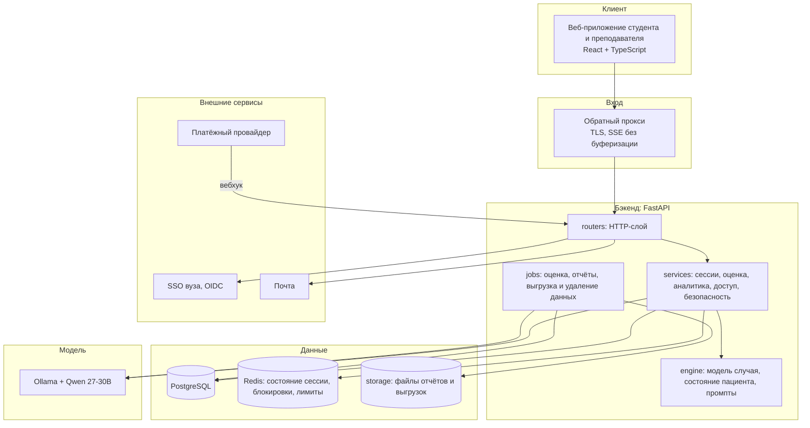
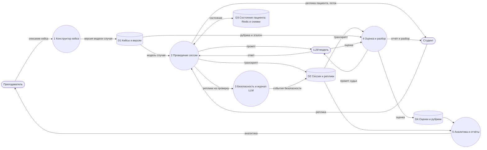
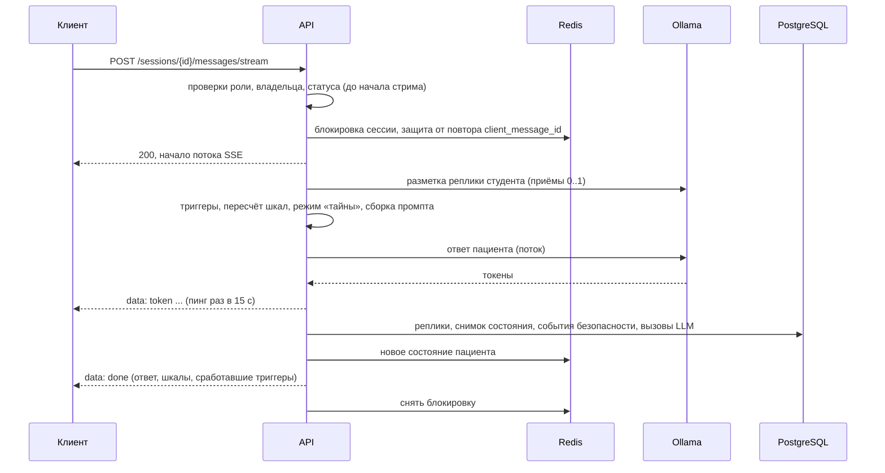

# Архитектура PsyTrainer

Платформа для тренировки навыков консультирования: студент ведёт диалог с ИИ-пациентом, система меняет его состояние
по правилам, затем разбирает сессию по рубрике. Языковая модель (Qwen через Ollama) только «играет роль»: что и как
должен делать пациент, решает код.

## ИТ-ландшафт

| Слой | Каталог | Что внутри |
|---|---|---|
| HTTP | `backend/app/routers/` | 13 файлов по группам эндпоинтов, проверка ролей, формат ответов |
| Бизнес-логика | `backend/app/services/` | цикл реплики, доступ к объектам, оценка, аналитика, проверка кейсов, безопасность |
| Ядро | `backend/app/engine/` | схемы модели случая, правила пересчёта шкал, сборка промптов. Без БД и сети |
| Инфраструктура | `backend/app/*.py` | конфиг, БД, Redis (`kv.py`), LLM (`llm.py`), почта, SSO, платежи, фоновые задачи |
| Данные | `backend/app/models.py`, `backend/alembic/` | 27 таблиц и миграции, см. [ER-диаграммы](erd.md) |

Все внешние зависимости собраны в `app/container.py`: в тестах их подменяют, в проде заменяют реализации
(например, Ollama на другую модель или очередь задач на ARQ) без правок остального кода.

## Диаграмма потоков данных (DFD, уровень 1)

## Жизненный цикл одной реплики

## Ключевые проектные решения

| Решение | Почему |
|---|---|
| Состояние пациента считает код, а не LLM | Предсказуемо, тестируется, объяснимо преподавателю; модель не «выздоравливает» за пару реплик |
| Версии кейса неизменяемы после публикации | Правки не ломают старые сессии и оценки |
| Структура случая скрыта от студента | Студент должен вывести её сам: это тренируемый навык |
| Оценка в фоне с привязкой баллов к репликам | LLM-судья медленный; студент видит, за какую реплику поставлен балл |
| Чужие объекты отдают 404 | Не раскрывать их существование |
| Один процесс API без внешней очереди | Достаточно для пилота; интерфейс `JobRunner.submit` рассчитан на замену |
